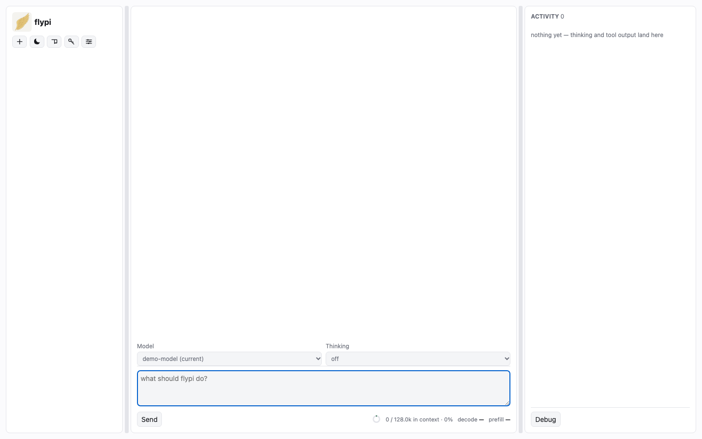

# flypi

A local, multi-model agent tool with a browser UI and a personal knowledge wiki, built on the
[pi SDK](https://www.npmjs.com/package/@earendil-works/pi-coding-agent) running in-process.
Everything it reads or writes lives in `.flypi/` — never in `~/.pi`.



## Install

```bash
npm install -g @makerstufferupper/flypi
```

Requires Node ≥ 22.19 (24 or newer is recommended, for the built-in `node:sqlite`).

## Run

```bash
flypi start      # starts the daemon and prints the URL with a per-run token
flypi status     # what is running, and which version
flypi logs -f
flypi stop
```

The first start downloads two local models (~900 MB) for the memory store — an embedder and a
contradiction judge. Skip them with `flypi start --embeddings none --judge none`.

## Docker

```bash
docker run -d --name flypi -p 127.0.0.1:8791:8791 -v flypi-data:/data makerstufferupper/flypi
open http://localhost:8791/
```

No start command: the container starts the daemon and prints its URL in `docker logs`. `-v flypi-data:/data`
is where `.flypi/` lives — conversations, the memory wiki, your config and the ~900 MB of models — so it
survives the container being removed; without it the download and everything you wrote go with it. Bind
`127.0.0.1:` unless you want the whole LAN to reach it: the page and `/healthz` are served without the token.

`docker stop` shuts the daemon down properly (an in-flight turn is recorded as interrupted, never re-run).
`docker exec flypi flypi status` and `... flypi logs -n 100` read the running daemon. `flypi update` does not
work in a container — the package is read-only there; rebuild the image instead.

`makerstufferupper/flypi` is published for `linux/amd64` and `linux/arm64`, and installs the published npm
package — the same code `npm install -g` gives you. Build it yourself with `docker build -t flypi .`;
`--build-arg FLYPI_VERSION=<version>` pins the version.

## Configure

`.flypi/agent/models.json` names your providers and models, and `.flypi/agent/settings.json` picks
the default pair. The settings page in the UI edits the same two files. Until you add a provider the
UI comes up normally and the model turn says out loud that no default is set.

## What you get

- A chat UI with thinking, tool output, sessions, and image paste.
- A memory wiki: every turn is searched against it before the model is asked anything, and the model
  can write to it over MCP.
- A daemon with a scheduler, a tool permission gate, and an encrypted secrets vault.
- Any endpoint pi supports, including local OpenAI-compatible servers.

## Releasing

Maintainers: the runbook is [docs/release.md](docs/release.md) and the rehearsal it starts with is
[docs/release-checks.md](docs/release-checks.md) — `npm run release:check`.

## License

MIT
